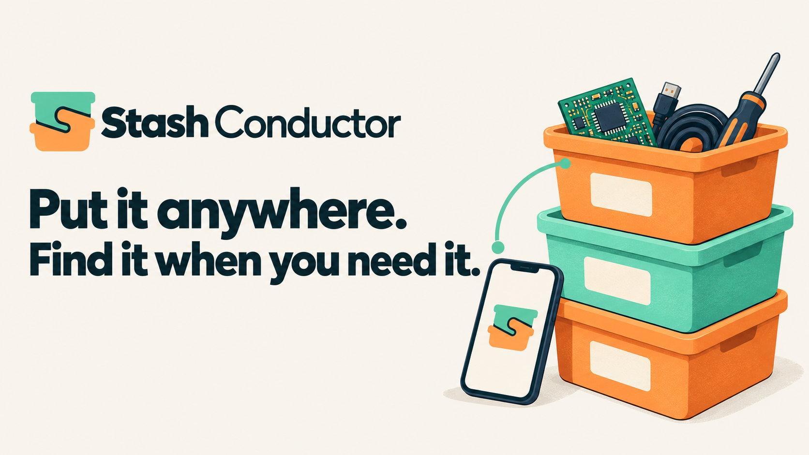

# Stash Conductor



**Put it anywhere. Find it when you need it.**

A small, mobile-first shared workshop inventory. Pick a tub once, capture a photo or rough description, and choose **Save & next**. Unknown boards, mixed cables and bags of screws are useful records without a catalogue or a precise count.

- Containers with permanent codes, locations and real QR labels; individual or batch creation.
- Photo-only capture, rough descriptions, fuzzy text search and original phrases preserved.
- Take out, return, move, missing/unknown location, used up, removal and revision-checked Undo.
- Atomic bulk movements, optional counted splits and optional electronics/device metadata.
- Shared household inventory with owner/member roles, local accounts or OIDC.
- Persistent device drafts, idempotent retries, protected original photos and auditable history.
- Installable PWA, camera QR scanner, manual codes and optional scoped Shortcut handoff.
- Configurable, disabled-by-default enrichment job; suggestions never change stock automatically.

## Quick start (local, trusted computer)

Requires Docker Compose. Clone the repository, then:

```sh
cp .env.example .env
# Replace SECRET_KEY with a unique random value in .env.
docker compose up -d --build
docker compose exec stash python manage.py account owner --owner
```

The account command prompts privately for a password (at least 12 characters). No default password or public registration exists. Open `http://localhost:8000`. Add members in Settings → User access, or run `python manage.py account NAME`. The same command resets a local password without SMTP; `--disable` disables an account. Keep at least one active owner.

For a phone or any network deployment, put the app behind a trusted HTTPS reverse proxy, preserve Host and X-Forwarded-Proto, set `ORIGIN=https://stash.example.com`, and expose only the proxy. The portable Compose file binds to localhost deliberately. Do not publish the backend directly. The proxy must enforce a 32 MB request limit. Camera, service worker and Home Screen support require HTTPS except on localhost.

## OIDC / Authentik

See [authentication](docs/authentication.md). `AUTH_MODE=oidc` completely disables local login and account recovery. There is no hidden local SSO bypass. OIDC uses authorization code + PKCE, state, nonce and server-side sessions. Stash uses immutable issuer + subject identities, never email-based automatic linking.

## Daily use

1. Create a container such as B014 and optionally enter its shelf/location. Print its QR label.
2. Scan or select the tub. The large **Adding to B014** heading stays visible.
3. Take a photo, enter a rough description, or dictate using the keyboard. Save & next.
4. Find by description, alias, visible marking or confirmed metadata. Open a result for take-out, return, move, corrections and history.

Count blank means unknown. A bag can remain one batch. “Not found here” retains its last tub while making uncertainty explicit. Moving a container changes its shared location, without rewriting its contents. Original images and history are retained when records are removed. There is no permanent-delete button.

Unsent drafts remain in IndexedDB under the signed-in user's namespace, bound to their original tub. Foreground reconnect retries use the same request key. Offline cold start shows a reconnect page; an already-open capture screen can keep drafts. Private pages, API responses and photos are never cached by the service worker. Signing out warns about unsaved work, clears account drafts and photos on that browser, and ends server access. Saved draft copies can also be cleared from Settings.

## Operations and development

- [API contract](docs/api.md)
- [Backup, restore and portable imports](docs/operations.md)
- [iPhone, QR, NFC and OpenTub checklist](docs/iphone.md)
- [Architecture decision and InvenTree trial](docs/adr-001.md)
- [Security boundaries](SECURITY.md)
- [Validation and limitations](docs/verification.md)
- [Artwork and dependency notices](NOTICE.md)

Python 3.12 local development:

```sh
python3.12 -m venv .venv
. .venv/bin/activate
pip install -r requirements.txt
export SECRET_KEY='local-development-only-replace-for-production'
python manage.py migrate
python manage.py account owner --owner
DEBUG=1 python manage.py runserver
python manage.py test
```

Use PostgreSQL only after adapting and testing the database configuration; this release targets a small SQLite household installation. No analytics, telemetry, external font requests or required AI service.

MIT for original code. Supplied generated raster artwork is included with the owner's permission; see notices. Contributions should preserve photo-first capture, unknown quantities and private-by-default deployment.

## Moving, tags and Brother labels

The moving workflow extends the original inventory with independent prepared tags, hierarchical physical locations, box packing states, durable local drafts and a conservative print queue. The pinned PT-P750W network bridge supports actual raster labels and reported tape checks. Firmware for a dedicated ESP32 reference station is included; commissioning hardware is separate from compiling it.

Read [daily packing](docs/packing.md), [Brother printing](docs/printing.md), [tag station build and commissioning](docs/tag-station.md), and [backup and relocation](docs/operations.md). Run tests with `requirements-test.txt`; production dependencies remain in `requirements.txt`.
